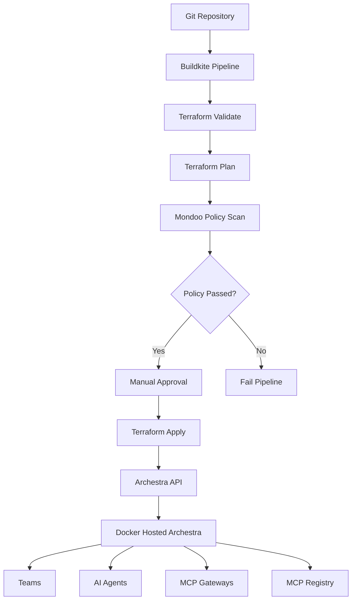

# 🤖 Archestra Terraform Module


## 📖 Overview

This Terraform module manages resources within an existing,
self-hosted **Archestra AI orchestration platform**.

It uses the official
[Archestra Terraform Provider](https://registry.terraform.io/providers/archestra-ai/archestra/latest/docs).

Archestra is already running on Docker. Terraform manages
the platform configuration through its API rather than
deploying or managing the Docker container.

## ✨ Features

- 👥 **Teams** — Manage Archestra teams
- 🤖 **AI Agents** — Configure agents and LLM models
- 🌐 **MCP Gateways** — Manage MCP gateways
- 📦 **MCP Registry** — Register MCP server definitions
- 🔐 **Security** — Configure access and trust settings
- 🏷️ **Labels** — Apply environment and ownership labels
- 🚀 **CI/CD** — Integrate with Buildkite
- 🛡️ **Policy as Code** — Integrate Mondoo scanning
- 📊 **Terraform State** — Track managed resources

## 🏗️ Architecture



## 📁 Repository Structure

```text
archestra-terraform/
├── .buildkite/
│   └── pipeline.yml
├── modules/
│   └── archestra/
│       ├── main.tf
│       ├── variables.tf
│       ├── outputs.tf
│       └── versions.tf
├── environments/
│   ├── dev/
│   └── prod/
└── README.md
```

## 📋 Prerequisites

Before deploying, ensure you have:

- Terraform installed
- Archestra Terraform provider available
- Running Archestra instance
- Archestra API endpoint
- Archestra API key
- Access to Terraform remote state
- Buildkite agent for CI/CD deployment

## 🔧 Provider Configuration

The official provider is available at:

https://registry.terraform.io/providers/archestra-ai/archestra/latest/docs

Example `versions.tf`:

```hcl
terraform {
  required_version = ">= 1.5.0"

  required_providers {
    archestra = {
      source = "archestra-ai/archestra"
    }
  }
}
```

Pin an approved provider version and commit
`.terraform.lock.hcl` for reproducible deployments.

## 🔑 Authentication

Configure the Archestra API endpoint and API key using
the authentication mechanism supported by your pinned
provider version.

Retrieve credentials from Vault during Buildkite execution.

Never commit API keys or credentials to Git.

## 🚀 Module Usage

```hcl
module "archestra" {
  source = "./modules/archestra"

  environment = "dev"

  teams = [
    "platform-engineering",
    "devops"
  ]

  mcp_catalog_items = {
    filesystem = {
      description = "Filesystem MCP Server"
      command     = "npx"
      arguments = [
        "-y",
        "@modelcontextprotocol/server-filesystem",
        "/workspace"
      ]
    }
  }

  mcp_gateways = {
    platform = {
      description = "Platform Engineering MCP Gateway"
      team        = "platform-engineering"
    }
  }

  agents = {
    devops = {
      description   = "DevOps engineering assistant"
      system_prompt = "Assist with Terraform and infrastructure."
      llm_model     = "gpt-4o"
      team          = "devops"
    }
  }
}
```

Validate the resource schema against the pinned provider
version before applying.

## ⚙️ Terraform Commands

### Initialise

```bash
terraform init
```

### Format

```bash
terraform fmt -recursive
```

### Validate

```bash
terraform validate
```

### Plan

```bash
terraform plan -out=tfplan
```

### Apply

```bash
terraform apply tfplan
```

## 🛡️ Security and Governance

| Control | Description |
|---------|-------------|
| 🔑 API Credentials | Retrieve credentials from Vault |
| 🔒 Least Privilege | Restrict access to agents and gateways |
| 👥 Team Isolation | Use team-scoped resources |
| 🏷️ Resource Labels | Identify environment and ownership |
| 🛡️ Mondoo | Enforce security policies |
| 📜 Audit Logging | Retain deployment logs |
| 🚫 Secret Protection | Avoid hardcoded credentials |
| 🔐 Remote State | Protect Terraform state |

Terraform state may contain sensitive resource attributes.

Use encrypted remote state with restricted access.

## 🔄 Buildkite Integration

The recommended deployment workflow:

1. 🧹 Terraform Format
2. 🔍 Terraform Validate
3. 📋 Terraform Plan
4. 🛡️ Mondoo Policy Scan
5. ✋ Manual Approval
6. 🚀 Terraform Apply
7. ✅ Post-Deployment Verification

### Example Buildkite Steps

```yaml
steps:
  - label: ":terraform: Terraform Validate"
    commands:
      - terraform fmt -check -recursive
      - terraform init -backend=false
      - terraform validate

  - label: ":shield: Mondoo Policy Scan"
    commands:
      - cnspec scan terraform . --policy-bundle mondoo/archestra.mql.yaml

  - block: ":hand: Approve Deployment"

  - label: ":rocket: Terraform Apply"
    commands:
      - terraform apply tfplan
```

This is a workflow illustration. Production Buildkite steps
must preserve the saved Terraform plan, configure agent
authentication, and establish explicit step dependencies.

## 📊 Module Inputs

| Variable | Description | Default |
|----------|-------------|---------|
| `environment` | Deployment environment | `dev` |
| `teams` | Archestra teams | `[]` |
| `mcp_catalog_items` | MCP server definitions | `{}` |
| `mcp_gateways` | MCP gateway definitions | `{}` |
| `agents` | AI agent definitions | `{}` |

## ⚠️ Important Notes

- Terraform manages Archestra platform resources, not Docker.
- Existing resources may require Terraform import.
- MCP catalog entries do not automatically install MCP servers.
- Agent configuration requires a supported LLM provider.
- Provider resource schemas may vary between versions.
- Review Terraform plans before production deployments.
- Validate Mondoo policy compatibility before enforcement.

## 📚 References

- [Archestra Terraform Provider](https://registry.terraform.io/providers/archestra-ai/archestra/latest/docs)
- [Terraform Documentation](https://developer.hashicorp.com/terraform/docs)
- [Mondoo Documentation](https://mondoo.com/docs/)
- [Buildkite Documentation](https://buildkite.com/docs)

---

**Maintained by:** Platform Engineering  
**Infrastructure:** Docker-hosted Archestra  
**Provisioning:** Terraform  
**CI/CD:** Buildkite  
**Policy Engine:** Mondoo
